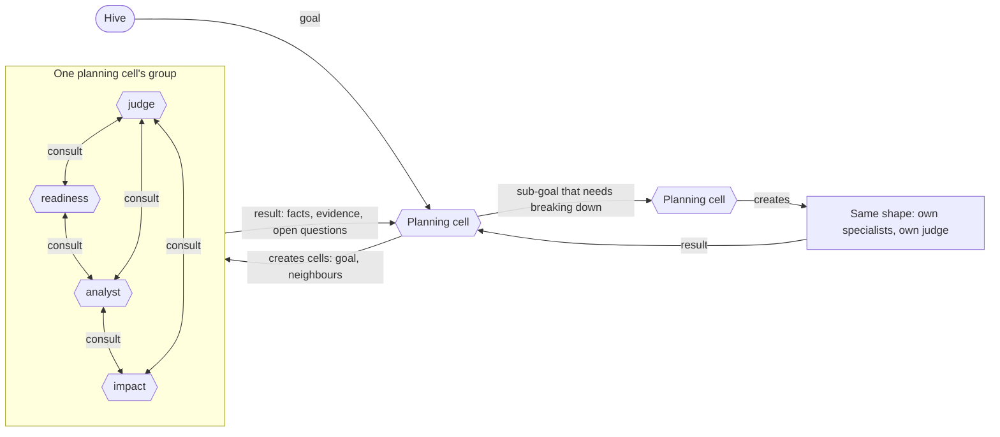
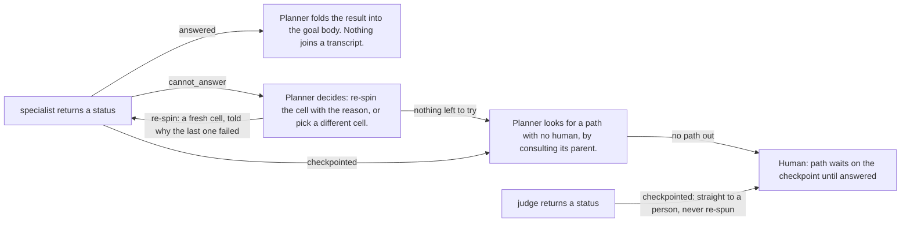

# Honeycomb

A hive is a set of hexagonal cells. Each cell is an agent that does one thing, and a cell can only talk to the cells it touches. The job is small. The model is not fixed: the planner chooses it for that cell from the local and frontier models available on the run.

This page is the picture. The architecture itself is in [architecture.md](architecture.md). How it is built is in the [tech stack](docs/stack.md), how it is instrumented is in [telemetry](docs/telemetry.md), and what has been tested, and what has not, is in [evidence](docs/evidence.md).

## Who talks to whom

A planning cell creates its specialists and one judge, and hands each cell a goal and its neighbours. Cells talk only across a touching edge, so "readiness" and "impact" cannot reach each other, while the judge touches all three. A sub-goal that needs breaking down goes to another planning cell, which repeats the same shape.

- The planner never appends results to a transcript. It folds each result into the goal and passes on only what the next cell needs, which keeps contexts small.
- A planner is not a neighbour. A specialist cannot reach out to one.
- Cell names here are illustrative.

The same diagram as Mermaid:

In the Mermaid version the cells that consult each other are joined by a two-way arrow. "readiness" and "impact" have no arrow between them.

## When a cell cannot answer

A reply carries one of three statuses. `answered` is folded into the goal. `cannot_answer` lets the planner re-spin or choose another cell, and when nothing is left it checkpoints. A checkpoint first looks for a way round the human, and only then waits on a person. The judge skips that search because it is already the last resort.

- Re-spins are limited by counters per cell, per planning cell and per hive, each with a maximum, a windowed maximum and a reset period.
- A re-spin and a judge call do not count towards depth.
- A judge that decides returns `answered`, and its verdict binds the cells in that group.

The same diagram as Mermaid:

## Where the detail is

- Planning, specialist and judge cells, re-spin, checkpoints and routing: [architecture.md](architecture.md).
- What industry practice and published research say for and against the design, and what could be incorporated: [docs/industry-research.md](docs/industry-research.md).
- The specialist catalogue, the planning and judge personas, and the result envelope: [drafts/specialists.md](drafts/specialists.md). It is a draft, and its proposals (the plan as data, the two-stage choice of cell) are not shown above.
